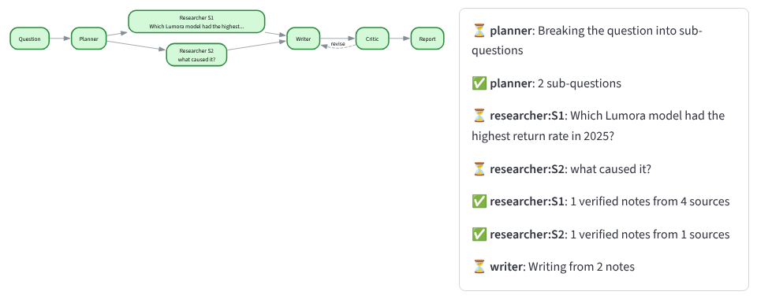

# Multi-Agent Research Team

Ask a question; four AI agents research it and write a cited brief, while you watch them work on a live graph.



- **Planner** splits the question into sub-questions.
- **Researchers** (one per sub-question, in parallel) search documents or the web and take notes with exact quotes.
- **Writer** drafts a brief where every sentence cites its notes, and lists what the sources do not say.
- **Critic** fact-checks each sentence against its quotes and can send the draft back once.

Between the agents, **code checks the model's work**: a note is dropped if its quote is not really in the cited source (numbers must match exactly), and sentences without valid citations go back to the Writer.

## Quick start (Windows)
```
py -m venv .venv
.venv\Scripts\activate.bat
pip install -r requirements.txt
copy .env.example .env          (then open .env and paste your free Gemini key)
streamlit run app.py
```
Free Gemini key: https://aistudio.google.com/apikey. Without a key the app runs in **offline mode** (no AI, copies sentences) so you can try the interface.

Command line:
```
python -m research_team ask "Which Lumora model had the highest return rate in 2025, and what caused it?"
python -m research_team ask "What is retrieval-augmented generation?" --web
python -m research_team evaluate
python -m pytest -q
```
Other providers: `--provider claude` (ANTHROPIC_API_KEY), `--provider ollama` (local model).

## Test documents
`corpus/` is about **Lumora Bikes, a fictional company** invented for this project. Because the model cannot know anything about it, every correct answer must come from the documents, which makes grounding measurable. Facts are spread across files, one figure is corrected in a later document, and two evaluation questions have no answer in the documents at all.

## Evaluation
`python -m research_team evaluate` runs 10 questions through the team and through a **single-call baseline** (retrieve once, ask once) and compares key-fact recall, citation validity, Critic-judged support, honesty on unanswerable questions, calls, tokens and time.

Results with `gemini-3.5-flash-lite` (free tier), 17 October 2026:

| Metric | Team | Single call |
|---|---|---|
| Key-fact recall | 0.969 | 0.844 |
| Sentences with valid citations | 1.0 | 1.0 |
| Sentences judged supported | 0.958 | 0.964 |
| Unanswerable questions handled honestly | 2/2 | 2/2 |
| LLM calls / tokens / seconds per question | 6.1 / 4181 / 9.6 | 1.0 / 1075 / 1.2 |

**Honest reading:** the recall gap comes from one question, where the single call's one search missed the right document and the Planner's sub-questions found it. Grounding quality was the same. The team costs about 4x the tokens and 8x the time. Full table: [reports/evaluation.md](reports/evaluation.md).

## Limitations
- Evaluation is 10 questions on a small fictional corpus written by the author.
- The "supported" score is judged by the same model that wrote the answer.
- Code can prove a quote exists in a source; it cannot prove the Writer's sentence means the same as the quote. That is the Critic's job, and the Critic can be wrong.
- Web mode depends on DuckDuckGo results and on pages that allow fetching.
- Free-tier rate limits make a full evaluation take several minutes.

More: [docs/ARCHITECTURE.md](docs/ARCHITECTURE.md).
