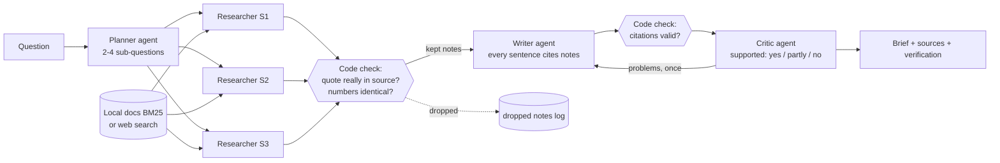

# Architecture

| Part | File | Job |
|---|---|---|
| Planner | agents.py `plan` | Splits the question; never answers it |
| Researcher | agents.py `research` | Searches, writes notes with an exact quote and source id |
| Writer | agents.py `write` | Brief from notes only; lists what the sources do not say |
| Critic | agents.py `critique` | Judges each sentence against its quotes |
| Guard rails | verify.py | Drops notes whose quote is not in the source (numbers must match exactly); flags uncited sentences |
| Orchestrator | orchestrator.py | Runs the team, researchers in parallel, one revision round, emits events for the live graph |
| LLM layer | llm.py | Gemini (default), Claude, Ollama, offline; JSON schema output; retry on rate limits; falls back if a model is retired |
| Search | sources.py | BM25 over local documents (no extra libraries) or DuckDuckGo + page fetch |
| Baseline | baseline.py | One retrieval + one model call, for comparison |

Design rule (same as the earlier projects): **the model writes, code checks**. A model can paraphrase badly
or invent a quote; code can verify that a quote exists in a source, but cannot judge meaning. So both are used.
